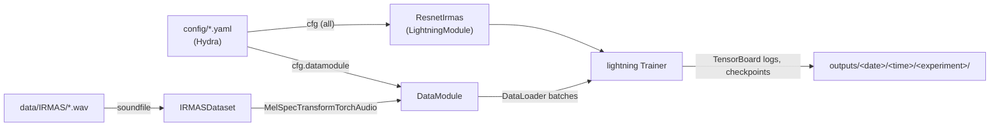

# Architecture

Multilabel classification of the 11 IRMAS instruments from mel spectrograms.
`train.py` composes the Hydra config, builds a Lightning `DataModule` and
`LightningModule`, and fits them.

| Component | Role | Config / code |
|-----------|------|---------------|
| `train.py` | entry point; callbacks, logger, `trainer.fit` | `config/config.yaml`, `config/trainer/` |
| `IRMASDataset` | lists files, train/val split by seed, loads audio, one-hot/multi-hot labels | `irmas_torch/datasets.py`, `config/datamodule/dataset/` |
| `MelSpecTransformTorchAudio` | mono mix → resample → mel spectrogram → normalize | `irmas_torch/transforms.py`, `config/datamodule/transform/` |
| `DataModule` | builds train/val/test datasets and loaders | `irmas_torch/lightning_modules.py`, `config/datamodule/` |
| `ResnetIrmas` | wraps the network (Hydra-instantiated), BCE loss, metrics, optimizer + plateau scheduler | `irmas_torch/lightning_modules.py`, `config/module/` |
| `Resnet18` / `Resnet34` | hand-written ResNets with "same" padding | `irmas_torch/networks.py` |

## Key mechanisms

- **Splits:** `IRMAS-TrainingData` (single label per clip) is shuffled with a
  fixed seed and cut at `train_fraq` into train/val. `IRMAS-TestingData`
  (multiple labels per clip, from `.txt` files) is the test set.
- **Time crops (`transform.time_slice`, seconds):** training clips are
  cropped at a random offset each time they're loaded, which acts as
  augmentation. Validation uses the centred crop (`random_slice=False`), so
  `val_*` metrics are comparable between epochs. Test clips (5–20 s) are not
  cropped. Crops are taken on raw audio, before resampling. Runs from before
  2026-10-27 ignored `time_slice` and trained on full 3 s clips, so their
  metrics aren't directly comparable.
- **Validation metrics:** recall, precision and F1 are macro-averaged over the
  11 labels at a 0.5 threshold. `val_accuracy` is *subset* accuracy
  (`torchmetrics.ExactMatch`: every label of a clip must be right), the same
  definition as sklearn's `accuracy_score` on multilabel input. Per-label
  `Accuracy` was rejected because the many true negatives inflate it (~0.9
  for a model that predicts nothing).
- **Watched metric:** early stopping, checkpointing and the LR scheduler
  (`ReduceLROnPlateau`) all follow `watch_metric` / `watch_metric_mode` in
  `config/config.yaml` (default `val_f1` / `max`). Change both together on
  the command line, e.g. `watch_metric=val_loss watch_metric_mode=min`.
- **Hydra instantiation:** the network and optimizer are created from
  `_target_` keys (`config/module/model/*.yaml`, `config/module/optimizer/*.yaml`).
  Add a new model by adding a yaml there.
- **Working directory:** Hydra changes into the run's output dir
  (`hydra.job.chdir: true`), and logs and checkpoints are written relative to
  it. See [decisions/003](decisions/003-hydra-1-4-pre-release-for-python-3-14.md).
